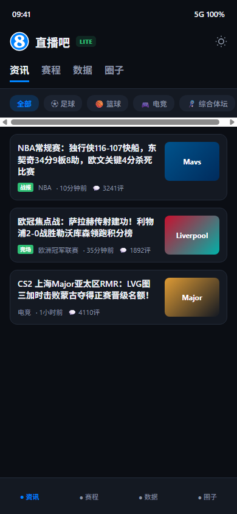
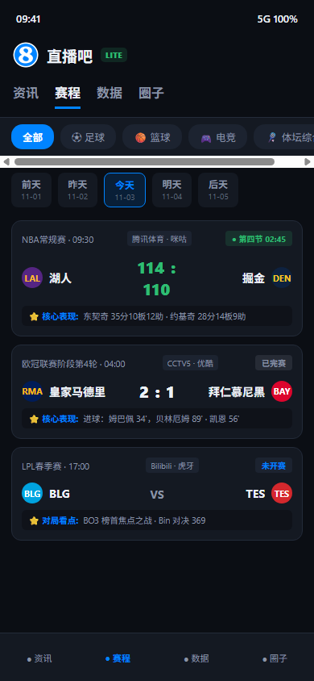
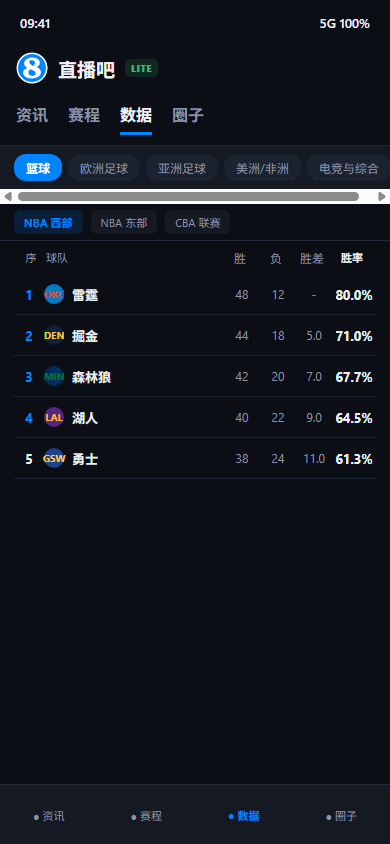

# 直播吧 X (zhibobaX / Zb8Lite)

> **纯原生、高密度、无广告的直播吧第三方轻量 Android 客户端**  
> 基于 Jetpack Compose + Material 3 构建，回归直播吧经典的「比赛时间轴 + 文字直播室 + 神评热议」核心体验，彻底剔除直播带货、弹窗导流与冗余信息流。

---

## 📸 应用界面截图

| 资讯首页（纯净无干扰） | 详细赛程（多项目与实时比分） | 官方数据板（实时积分） |
| :---: | :---: | :---: |
|  |  |  |

---

## ✨ v3.0 ~ v3.1 核心特性

### 1. 直播吧原味视觉与门户习惯
- **经典配色体系**：清爽直播蓝（`#1E88E5`）+ 直播翡翠绿（`#10B981`）+ 神评火焰橙红（`#FF5722`），白底卡片为主场，提供**中性深色**与 **AMOLED 纯黑（`#000000`）** 独立模式及 4 档正文字号缩放。
- **默认首屏可选**：默认以「比赛」页作为启动首屏（贴合老吧友看球习惯），也可在「我的与设置」中切换为「资讯头条」启动。

### 2. 高密度实时赛程 + 原生文字直播室
- **实时比分流融合**：当日赛程接入 `bifen4m.qiumibao.com/json/list.htm` 与 `s.qiumibao.com` 精准融合，修复多日历切换默认下标与比分数值比较 Bug，支持当日 15 秒轻量轮询刷新。
- **全原生比赛直播室**：点击任意比赛进入原生直播室，展示**单节/半场小分表**、**每 10 秒自动刷新的中文逐回合文字直播流**以及**双方球星核心技术统计**（视频集锦保留全屏 Web 播放兜底）。

### 3. 原生资讯正文 + 「🔥 神评热议」楼中楼
- **原生图文与动图**：直连解析直播吧移动版正文，支持 GIF 动图原画播放、全屏手势缩放与一键保存相册。
- **神评与楼中楼**：直连 `cache.zhibo8.cc` 静态评论 CDN，原生渲染「🔥 神评热议」与全量评论分页，支持 `👍 / 👎` 计数与嵌套楼中楼回复展示。

### 4. 全联赛数据榜 + 全赛季赛程 + 近 5 日新闻归档
- **完整联赛榜单**：覆盖 **NBA、CBA、英超、西甲、意甲、德甲、法甲、欧冠、中超、沙特联、美职联**；足球补齐**射手榜 & 助攻榜**，NBA 补齐**得分榜 / 篮板榜 / 助攻榜**。
- **原生球队与球员详情（v3.1 新增）**：
  - 点击积分榜/排名中的任意球队：接入足球/CBA **全赛季赛程表**与 NBA 近半月赛程归档，同时检索直播吧近 5 日全量新闻归档（`news.zhibo8.cc/{nba|zuqiu}/json/{date}.htm`），精准展示该队完整战绩、未来赛程与相关资讯。
  - 点击球员榜中的任意球员：展示球员当季排行与核心数据、近 5 日全站关联新闻及所属球队赛程。

### 5. 「我的主队」与本地收藏/足迹
- **主队订阅**：支持自由添加/星标置顶主队，自动聚合该队的近期赛程战绩与近 5 日全站快讯。
- **本地收藏与足迹**：免登录即可本地收藏喜爱的新闻并管理浏览足迹。

---

## 🛠️ 技术架构

- **UI 框架**：Jetpack Compose + Material 3 + Navigation Compose (`NavHost`)
- **网络与解析**：OkHttp 4.12 + Jsoup 1.18 + 原生 `org.json`
- **图片与动图**：Coil 2.7 + `coil-gif`
- **本地存储**：SharedPreferences + Kotlin `StateFlow`
- **测试与构建**：JUnit4 联网接口单元测试（`Zb8ApiLiveTest`）+ Gradle 8.9 + Kotlin 2.0.21

---

## 📦 下载与安装

- **最新正式版 (v3.1.0)**：[Zb8Lite-v3.1.0.apk](https://github.com/whh110112/zhibobaX/releases/download/v3.1.0/Zb8Lite-v3.1.0.apk)
- **全部版本发布页**：[GitHub Releases](https://github.com/whh110112/zhibobaX/releases)
- **系统要求**：Android 8.0 (API 26) 及以上，目标 SDK 35

---

## ⚖️ 免责声明与版权条款

> 1. **仅供个人学习交流使用，严禁任何商业用途**：  
>    本项目及编译生成的 APK 仅供个人技术研究与 Android 现代架构学习交流使用，严禁用于任何商业用途或二次打包分发。
> 2. **基于公开接口开发**：  
>    本项目所有数据均来自公开可访问的网页及移动端接口，未包含任何逆向破解或私有鉴权绕过逻辑。
> 3. **商标归属**：  
>    “直播吧”及其相关图标、队徽、赛事标识等知识产权归属于厦门傲灵信息科技有限公司及其关联权利方所有。如有侵权请联系移除。
