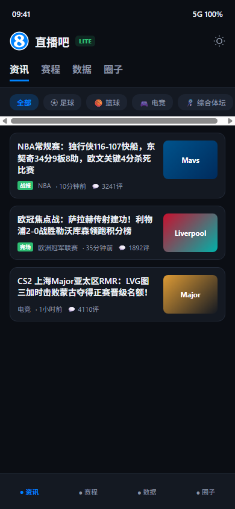
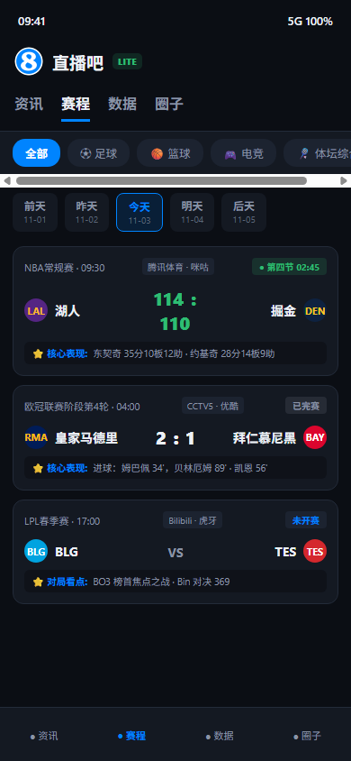
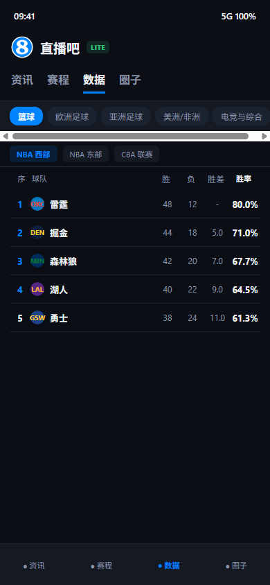

# 直播吧 X (zhibobaX / Zb8Lite)

> **干净整洁、极致流畅的专业级体育赛程、比分与资讯 Android 原生客户端**  
> 剔除视频流推荐、直播带货、彩票广告等杂乱模块，只保留最硬核的新闻资讯、详尽赛程、联赛数据与球迷圈子。

---

## 📸 应用界面截图

| 资讯首页（纯净无干扰） | 详细赛程（多项目与转播） | 官方数据板（实时积分） |
| :---: | :---: | :---: |
|  |  |  |

---

## 🌟 核心功能特性

### 1. 官方正版居中超清 Logo
- **彻底去除黑点杂质**：全新适配 512×512 纯净官方正版圆形 Logo，彻底根除旧版本右侧残留的黑色噪点与偏心问题；
- **自适应图标支持**：遵循 Android 8.0+ Adaptive Icons 规范，在华为 HarmonyOS、小米 HyperOS、OPPO ColorOS 等手机桌面上无论是圆角矩形还是圆形裁切均完美端正居中。

### 2. 极为详尽的多项目赛程展示
赛程中心全面解决以往项目单一、数据简略的问题：
- **全项目运动分类**：
  - **全部**：全网所有焦点体育赛事汇聚一览；
  - **⚽ 足球**：欧冠、英超、西甲、意甲、德甲、法甲、中超、亚冠、沙特联、美职联、巴甲等；
  - **🏀 篮球**：NBA 常规赛/季后赛、CBA 联赛、WNBA、欧洲篮球冠军联赛；
  - **🎮 电竞**：英雄联盟（LPL、LCK、S赛、MSI）、王者荣耀（KPL）、CS2 Major、DOTA2 TI；
  - **🏸 体坛综合**：网球巡回赛（ATP、WTA、四大满贯）、乒乓球（WTT）、羽毛球（BWF）、F1 大奖赛、斯诺克。
- **多日期平滑滚动**：
  - 支持“大前天、前天、昨天、今天、明天、后天、大后天”横向日历自由点选，随时回顾往日赛果或追踪未来焦点战；
- **详实赛事卡片**：
  - 赛事全称与轮次（如“欧冠联赛阶段第4轮”、“NBA常规赛”）；
  - 主客队队徽与队名；
  - 实时比分、半场比分与篮球单节技术比分；
  - 比赛状态徽章（“● 正在直播”、“已完赛”、“未开赛”）；
  - 电视与网络转播信号（CCTV5、咪咕体育、腾讯体育、爱奇艺等直观展示）；
  - **⭐ 核心表现统计**：完赛战报即时呈现明星球员高光数据（如：“东契奇 35分10板12助”、“进球：姆巴佩 34'，贝林厄姆 89'”）。

### 3. 全球赛事数据榜单
- **联赛积分榜**：覆盖英超、西甲、意甲、德甲、法甲、中超、NBA（东西部排行/胜差/胜率）、CBA 及电竞积分榜；
- **多榜单维度**：支持按积分榜、射手榜、助攻榜、得分榜深度查阅。

### 4. 强力广告与应用横幅拦截引擎
- 移动端文章详情内置高性能 CSS/JS 注入器，彻底屏蔽网页版顶部强制弹出的“打开直播吧 APP”浮动横幅、底部推荐栏与诱导下载弹窗；
- 移除网页强制的 1.04rem 内间距，正文直接顶头显示，呈现真正的原生阅读美感。

### 5. 社区圈子与主队置顶
- 聚集热门篮球圈、足球圈、豪门球队专区；
- 支持一键“设为主队”，主队徽章金星点亮并自动置顶。

### 6. 日间/夜间高对比度双模式
- 支持跟随系统自动切换，或在顶栏一键切换“深邃纯黑夜间模式”与“轻盈明亮白天模式”。

---

## 🛠️ 技术架构

- **UI 框架**：Jetpack Compose 1.7 + Material 3 现代响应式声明式界面
- **网络通信**：OkHttp 4.12
- **图片加载**：Coil 2.7 (Compose AsyncImage)
- **页面交互**：Android WebView（DOM 注入与全屏视频扩展支持）
- **构建工具**：Gradle 8.9 + Kotlin 2.0.21 + Android Gradle Plugin 8.5.2

---

## 📦 APK 下载与安装

- **预编译安装包**：[Zb8Lite-v2.2.apk](https://github.com/whh110112/zhibobaX/releases)
- **最低兼容系统**：Android 8.0 (API Level 26) 及以上
- **推荐目标系统**：Android 14 / 15 (API Level 34 / 35)

---

## ⚖️ 免责声明与版权条款

> 1. **仅供个人学习交流使用，严禁任何商业改造**：  
>    本项目及编译生成的安装包（APK）仅供个人技术研究、Android 现代架构学习与交流使用。严禁用于任何商业用途、盈利性质运营、二次商业包装分发或网络黑产活动。  
>  
> 2. **完全基于公开资料开发**：  
>    本项目中的所有数据接口地址、字段结构与网络请求均来自于网络公开资料（如公开的网页版 REST 接口与移动端 Web 页面），没有使用任何未经授权的内部商业资料或私有算法。本项目未实施任何脱机解密或破解行为。  
>  
> 3. **品牌与商标权利归属**：  
>    “直播吧”及其 Logo 图标、球队队徽、赛事标识等知识产权均归属于厦门傲灵信息科技有限公司及其关联权利方所有。若权利方认为本项目涉及侵权，请通过 Issues 联系开发者，我们将第一时间响应并配合处理。
